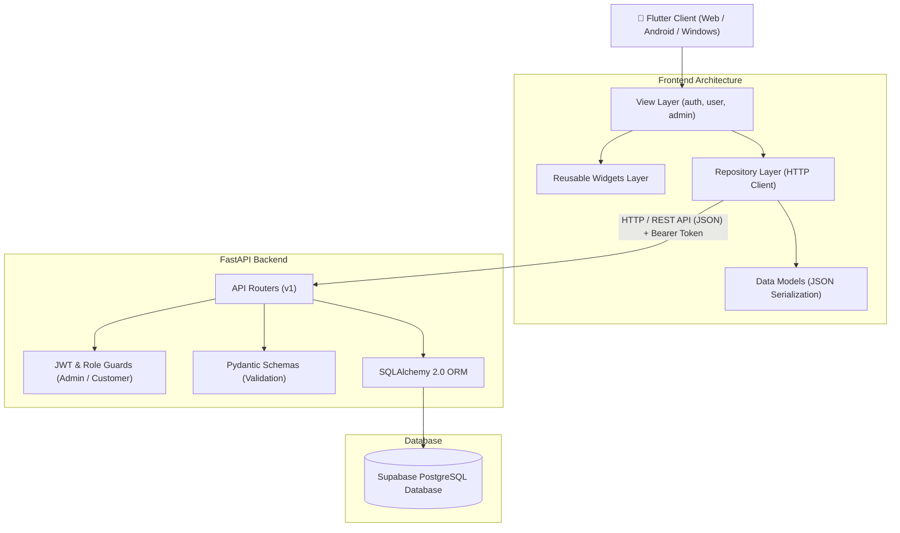
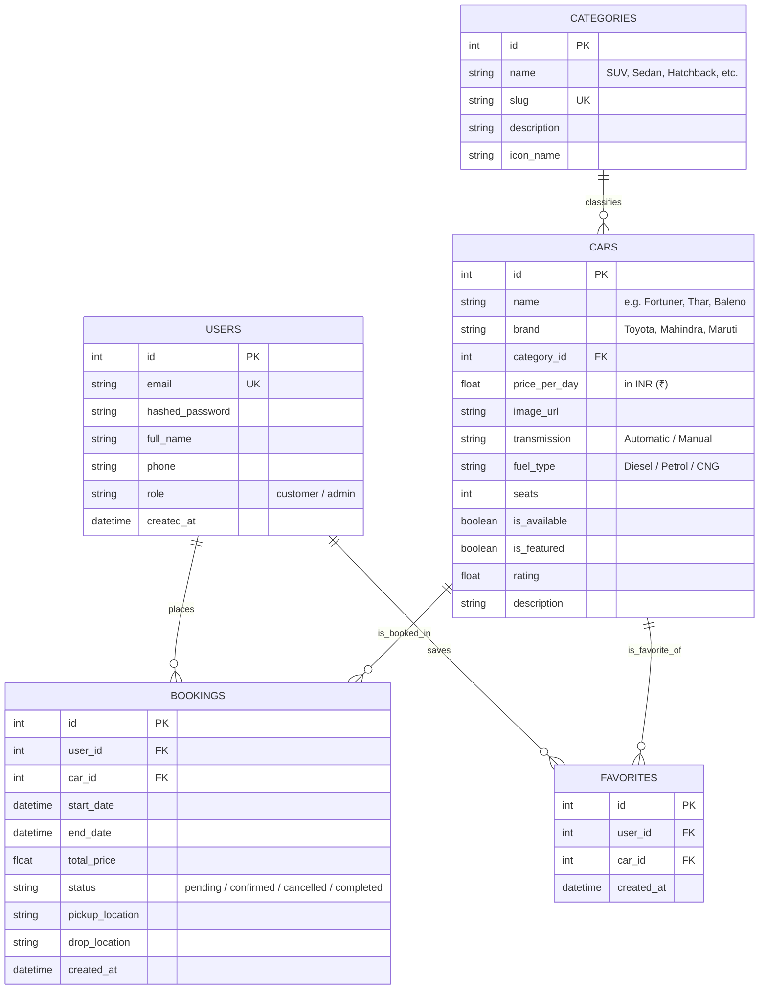

# SG CAR RENT 🚗⚡
### Full-Stack Car Rental Application • Flutter • FastAPI • PostgreSQL (Supabase)
*Prepared for Academic Project Review, Viva Demonstration & Production Showcase*

---

## Document Control

| Item | Details |
|---|---|
| **Project Name** | **SG Car Rent** |
| **Project Type** | Full-Stack On-Demand Car Rental Application |
| **Frontend** | Flutter 3.44+ / Dart 3.x (Material 3 Dark Theme) |
| **Backend** | FastAPI (Python 3.13) / Uvicorn ASGI Server |
| **Database** | PostgreSQL hosted on **Supabase** (SQLite supported as local dev fallback) |
| **Authentication** | JWT (JSON Web Tokens) with Bcrypt password hashing & Role-Based Access Control (RBAC) |
| **Primary Roles** | **Customer / User** and **Administrator** |
| **Architecture** | Clean Architecture / Repository Pattern (Frontend) + Modular Router Pattern (Backend) |
| **Document Version** | 1.0 (Production Verified) |

---

## Table of Contents
1. [Executive Summary](#1-executive-summary)
2. [Introduction](#2-introduction)
3. [Real-World Problem and Proposed Solution](#3-real-world-problem-and-proposed-solution)
4. [Objectives and Scope](#4-objectives-and-scope)
5. [Users and Use Cases](#5-users-and-use-cases)
6. [Technology Stack](#6-technology-stack)
7. [System Architecture](#7-system-architecture)
8. [Functional Requirements](#8-functional-requirements)
9. [Non-Functional Requirements](#9-non-functional-requirements)
10. [Application Modules and Screens](#10-application-modules-and-screens)
11. [Database Design & Entity Relationship Diagram](#11-database-design--entity-relationship-diagram)
12. [API Documentation & HTTP Contract](#12-api-documentation--http-contract)
13. [Authentication, Authorization & Role Routing](#13-authentication-authorization--role-routing)
14. [Main Workflows](#14-main-workflows)
15. [Frontend Folder Structure](#15-frontend-folder-structure)
16. [Backend Folder Structure](#16-backend-folder-structure)
17. [Setup and Execution Guide](#17-setup-and-execution-guide)
18. [Testing and Validation Plan](#18-testing-and-validation-plan)
19. [Error Handling and Troubleshooting](#19-error-handling-and-troubleshooting)
20. [Security, Privacy and Engineering Practices](#20-security-privacy-and-engineering-practices)
21. [Future Enhancements](#21-future-enhancements)
22. [Conclusion](#22-conclusion)
23. [Viva Questions and Answers (Comprehensive Q&A)](#23-viva-questions-and-answers)
* [Appendix A: Demo Checklist](#appendix-a-demo-checklist)
* [Appendix B: Test Credentials](#appendix-b-test-credentials)

---

## 1. Executive Summary

**SG Car Rent** is an enterprise-grade full-stack automotive platform designed to eliminate the friction in discovering, comparing, and renting vehicles across India. The application features a cross-platform client built in **Flutter** presenting a luxury, dark-themed automotive UI with zero loading lag and offline-first asset capabilities. 

The application is powered by an asynchronous **FastAPI** REST backend communicating with **Supabase PostgreSQL** via **SQLAlchemy 2.0 ORM**. Role-Based Access Control (RBAC) securely demarcates Customer capabilities (browsing, real-time date selection, booking, and favorites) from Administrator controls (fleet CRUD, booking moderation, and operational statistics).

---

## 2. Introduction

Vehicle rental companies frequently face operational overhead when coordinating vehicle fleets, calendar availability, customer credentials, and rental tariffs manually across phone calls and spreadsheets. This manual workflow creates data redundancy, delayed responses, and booking conflicts.

**SG Car Rent** unifies fleet discovery and administrative logistics into a centralized, modern full-stack system:
* **Customers** gain transparency with real-time specs, seating, transmission, fuel type, daily pricing in INR (`₹`), and immediate booking reservations.
* **Administrators** control the entire fleet lifecycle, pricing modifications, and reservation approvals via an isolated admin interface.
* **Engineering Rigor:** Demonstrates modular architecture, DTO/Schema validation using Pydantic v2, JWT stateless authorization, and a structured Flutter client.

---

## 3. Real-World Problem and Proposed Solution

### 3.1 Problem Statement
* **Information Asymmetry:** Customers lack a transparent, real-time catalog of available vehicles, specs, and true pricing.
* **Manual Booking Overhead:** Booking via telephone or chat leaves no persistent audit trail and frequently leads to double-booking.
* **Unstructured Administration:** Rental operators lack role-protected portals to update prices or manage vehicles without engineering assistance.

### 3.2 Proposed Solution
1. **Centralized Digital Catalog:** High-resolution multi-category fleet (SUV, Luxury Sedan, MUV, Hatchback, Tempo Traveller) with real-time specs.
2. **Automated Price Calculation:** Dynamic rental duration and tariff computation (`days * price_per_day`) validated securely on the server.
3. **Role-Protected Operations:** JWT-guarded REST APIs enforcing strict backend authorization boundaries between customer actions and administrative controls.
4. **Resilient Image Handling:** Dual-layer offline asset bundling with automatic network fallbacks.

### 3.3 Expected Benefits
| Stakeholder | Expected Benefit |
|---|---|
| **Customer** | Frictionless vehicle discovery, upfront INR pricing, clear booking timeline, and wishlist tracking. |
| **Administrator** | Instant fleet updates (Add/Edit/Delete), booking status lifecycle control (Confirm/Cancel/Complete). |
| **Evaluator / Examiner** | Real-world full-stack implementation demonstrating REST APIs, JWT authentication, and clean folder separation. |

---

## 4. Objectives and Scope

### 4.1 Objectives
* Deliver an intuitive, high-performance Flutter frontend adhering to Material 3 dark aesthetics.
* Expose asynchronous RESTful APIs with FastAPI and Pydantic validation.
* Implement stateless token authentication with Bcrypt password hashing.
* Structure data in a relational PostgreSQL schema (Supabase) enforcing foreign-key integrity.
* Maintain beginner-friendly, clean architecture: `const`, `model`, `repo`, `widgets`, and role-based `view` subfolders.

### 4.2 In Scope
* Splash screen with offline asset loading and 3-step onboarding carousel.
* Authentication suite: Sign In, Sign Up, and Password Reset Request.
* Customer catalog: Category filtering, search by brand/model, and detailed vehicle specs.
* Date-picker booking reservation with dynamic cost estimation and booking receipts.
* Customer booking management (view history, cancel pending reservations).
* Wishlist / Favorites toggle with persistent backend sync.
* Administrator dashboard with real-time fleet counters, Add/Edit/Delete car forms, and booking approvals.

### 4.3 Out of Scope (Planned for Future Releases)
* Live payment gateway integrations (Razorpay / Stripe) and merchant payouts.
* Telematics GPS tracking and keyless IoT hardware integration.
* Government ID verification (Aadhaar/Driving License KYC).
* Automated SMS/WhatsApp notification delivery.

---

## 5. Users and Use Cases

| Role | Use Case | Expected Behavior |
|---|---|---|
| **Guest** | Explore catalog | Views public car fleet and categories without requiring login. |
| **Customer** | Register & Sign In | Submits credentials; receives JWT token and role routing. |
| **Customer** | Filter & View Specs | Filters fleet by SUV/Sedan/Hatchback; inspects transmission, seats, fuel. |
| **Customer** | Book a Vehicle | Selects start/end dates; backend validates availability and creates reservation. |
| **Customer** | View/Cancel Bookings | Views active/past rentals; cancels allowed bookings with real-time status update. |
| **Customer** | Toggle Wishlist | Adds/removes vehicles from personal favorites list. |
| **Administrator** | Manage Fleet | Creates new car records, edits daily rates, or deletes cars from fleet. |
| **Administrator** | Moderate Bookings | Reviews customer reservations; transitions status between Confirmed/Cancelled/Completed. |

---

## 6. Technology Stack

```
Frontend:   Flutter 3.44+ | Dart 3.x | Material 3 Dark UI | http package | shared_preferences
Backend:    FastAPI 0.115+ | Python 3.13 | Uvicorn ASGI | Pydantic v2 | Passlib (Bcrypt)
Database:   PostgreSQL (Supabase) | SQLAlchemy 2.0 ORM | Alembic
Auth:       OAuth2 Password Bearer | JWT (HS256) | Role-Based Access Control (RBAC)
```

---

## 7. System Architecture



---

## 8. Functional Requirements

| ID | Requirement | Description |
|---|---|---|
| **FR-01** | User Registration | Validates email, password, full name, and phone to create customer accounts. |
| **FR-02** | User Authentication | Validates credentials, verifies Bcrypt hash, and issues signed JWT bearer tokens. |
| **FR-03** | Role-Based Routing | Redirects users upon login to `HomeScreen` (Customer) or `AdminDashboard` (Admin). |
| **FR-04** | Fleet Exploration | Displays 60+ real Indian vehicles across 8 categories with search and filters. |
| **FR-05** | Specifications Display | Displays seats, transmission, fuel, daily tariff in INR (`₹`), and ratings. |
| **FR-06** | Rental Booking | Collects rental date ranges and creates reservations linked to the customer. |
| **FR-07** | Booking Management | Enables customers to review booking history and cancel pending bookings. |
| **FR-08** | Wishlist / Favorites | Allows authenticated users to bookmark cars with instant sync. |
| **FR-09** | Admin Fleet CRUD | Enables verified administrators to Add, Edit, and Delete vehicle records. |
| **FR-10** | Admin Booking Moderation | Allows administrators to inspect all customer bookings and update status. |
| **FR-11** | Smart IP Detection | Automatically maps API URLs to `10.0.2.2` (Android) or `127.0.0.1` (Web/Desktop). |
| **FR-12** | Resilient Image Fallback | Loads local assets first; seamlessly falls back to network images if required. |

---

## 9. Non-Functional Requirements

* **Security:** Backend enforces role guards on every protected route. Passwords are never stored in plaintext.
* **Performance:** Asynchronous FastAPI endpoints respond in <50ms; Flutter 60 FPS rendering.
* **Maintainability:** Separation of concerns across `auth/`, `admin/`, and `user/` screen directories.
* **Reliability:** Network exceptions trigger user-friendly error dialogs/snackbars without application crashes.
* **Data Integrity:** Foreign-key constraints and date validations (`end_date > start_date`) enforced at the database layer.

---

## 10. Application Modules and Screens

The Flutter frontend is systematically partitioned into three functional domains inside `frontend/lib/view/`:

```
frontend/lib/view/
├── 🔐 auth/       # 5 Authentication & Onboarding screens
├── 👑 admin/      # 6 Fleet & Reservation Management screens
└── 👤 user/       # 11 Customer Discovery & Booking screens
```

### 10.1 Authentication & Onboarding Module (`lib/view/auth/`)
1. **[splash_screen.dart](file:///c:/flutter practice/sg car rent app/frontend/lib/view/auth/splash_screen.dart):** Brand splash header with offline asset car and automatic JWT token check.
2. **[onboarding_screen.dart](file:///c:/flutter practice/sg car rent app/frontend/lib/view/auth/onboarding_screen.dart):** 3-page interactive carousel ("Luxury Cars", "Rent, Drive, Explore", "Your Ride").
3. **[login_screen.dart](file:///c:/flutter practice/sg car rent app/frontend/lib/view/auth/login_screen.dart):** Mercedes AMG studio hero card, email/password form, and role-based redirect.
4. **[register_screen.dart](file:///c:/flutter practice/sg car rent app/frontend/lib/view/auth/register_screen.dart):** BMW M Sport studio hero card, full name, email, phone, and password creation.
5. **[forgot_password_screen.dart](file:///c:/flutter practice/sg car rent app/frontend/lib/view/auth/forgot_password_screen.dart):** Porsche studio hero card with email recovery request.

### 10.2 Customer / User Module (`lib/view/user/`)
1. **[home_screen.dart](file:///c:/flutter practice/sg car rent app/frontend/lib/view/user/home_screen.dart):** Featured vehicles carousel, category quick-filters, and promo banner.
2. **[explore_cars_screen.dart](file:///c:/flutter practice/sg car rent app/frontend/lib/view/user/explore_cars_screen.dart):** Full fleet grid with instant search and category filter chips.
3. **[car_details_screen.dart](file:///c:/flutter practice/sg car rent app/frontend/lib/view/user/car_details_screen.dart):** Hero vehicle image, full specifications matrix, and Book Now action.
4. **[booking_date_screen.dart](file:///c:/flutter practice/sg car rent app/frontend/lib/view/user/booking_date_screen.dart):** Interactive calendar date-range picker with live tariff calculation.
5. **[booking_confirmation_screen.dart](file:///c:/flutter practice/sg car rent app/frontend/lib/view/user/booking_confirmation_screen.dart):** Verified reservation summary and digital receipt.
6. **[booking_details_screen.dart](file:///c:/flutter practice/sg car rent app/frontend/lib/view/user/booking_details_screen.dart):** Detailed inspection of specific reservation dates and pickup locations.
7. **[my_bookings_screen.dart](file:///c:/flutter practice/sg car rent app/frontend/lib/view/user/my_bookings_screen.dart):** List of past and active bookings with color-coded status badges and cancellation.
8. **[favorites_screen.dart](file:///c:/flutter practice/sg car rent app/frontend/lib/view/user/favorites_screen.dart):** Bookmarked wishlist vehicles.
9. **[profile_screen.dart](file:///c:/flutter practice/sg car rent app/frontend/lib/view/user/profile_screen.dart):** User account details, contact information, and secure sign-out.
10. **[edit_profile_screen.dart](file:///c:/flutter practice/sg car rent app/frontend/lib/view/user/edit_profile_screen.dart):** Name and phone update form.
11. **[notifications_screen.dart](file:///c:/flutter practice/sg car rent app/frontend/lib/view/user/notifications_screen.dart):** User activity alerts.

### 10.3 Administrator Module (`lib/view/admin/`)
1. **[admin_dashboard.dart](file:///c:/flutter practice/sg car rent app/frontend/lib/view/admin/admin_dashboard.dart):** Fleet counters, total bookings, revenue summary, and quick management links.
2. **[manage_cars_screen.dart](file:///c:/flutter practice/sg car rent app/frontend/lib/view/admin/manage_cars_screen.dart):** Complete car fleet listing with Edit and Delete capabilities.
3. **[add_car_screen.dart](file:///c:/flutter practice/sg car rent app/frontend/lib/view/admin/add_car_screen.dart):** Multi-attribute vehicle creation form (Brand, Model, Category, Price, Seats, Transmission).
4. **[edit_car_screen.dart](file:///c:/flutter practice/sg car rent app/frontend/lib/view/admin/edit_car_screen.dart):** Vehicle update form to adjust pricing, description, or availability.
5. **[manage_bookings_screen.dart](file:///c:/flutter practice/sg car rent app/frontend/lib/view/admin/manage_bookings_screen.dart):** Central booking management to Confirm, Complete, or Cancel reservations.
6. **[admin_profile_screen.dart](file:///c:/flutter practice/sg car rent app/frontend/lib/view/admin/admin_profile_screen.dart):** Admin credentials view and session termination.

---

## 11. Database Design & Entity Relationship Diagram



---

## 12. API Documentation & HTTP Contract

All endpoints are hosted under the base prefix: `/api/v1`

| Method | Endpoint | Access Level | Description |
|---|---|---|---|
| `POST` | `/api/v1/auth/register` | Public | Register new customer account |
| `POST` | `/api/v1/auth/login` | Public | Authenticate credentials & return JWT |
| `GET` | `/api/v1/auth/me` | Authenticated | Retrieve current user profile |
| `POST` | `/api/v1/auth/forgot-password` | Public | Submit password recovery request |
| `GET` | `/api/v1/cars` | Public | List all fleet vehicles with optional category filter |
| `GET` | `/api/v1/cars/featured` | Public | Retrieve curated featured cars for carousel |
| `GET` | `/api/v1/cars/{id}` | Public | Retrieve full specs of a single vehicle |
| `GET` | `/api/v1/categories` | Public | List car categories with iconography |
| `POST` | `/api/v1/bookings` | Customer | Submit rental booking reservation |
| `GET` | `/api/v1/bookings/my` | Customer | List all bookings belonging to the user |
| `PUT` | `/api/v1/bookings/{id}/cancel` | Customer | Cancel an owned pending reservation |
| `GET` | `/api/v1/favorites` | Customer | Retrieve user's bookmarked cars |
| `POST` | `/api/v1/favorites/{car_id}` | Customer | Add a vehicle to favorites |
| `DELETE` | `/api/v1/favorites/{car_id}` | Customer | Remove a vehicle from favorites |
| `POST` | `/api/v1/admin/cars` | **Admin Only** | Add new car record to the fleet |
| `PUT` | `/api/v1/admin/cars/{id}` | **Admin Only** | Update existing car specs, pricing, availability |
| `DELETE` | `/api/v1/admin/cars/{id}` | **Admin Only** | Remove car record from the database |
| `GET` | `/api/v1/admin/bookings` | **Admin Only** | View and moderate all customer bookings |

---

## 13. Authentication, Authorization & Role Routing

### 13.1 Authentication Handshake
```
1. Client submits: POST /api/v1/auth/login { "email": "...", "password": "..." }
2. Backend queries database for user record by email.
3. Passlib verifies the plain password against the Bcrypt hash.
4. If valid, FastAPI creates a signed JWT token containing:
   { "sub": user.email, "role": user.role, "exp": expiration_timestamp }
5. Client receives: { "access_token": "...", "token_type": "bearer", "user": { "role": "admin"|"customer" } }
6. Token is cached in SharedPreferences.
7. Subsequent API calls attach: Authorization: Bearer <access_token>
```

### 13.2 Role Separation
* **Client-Side Routing:** Flutter checks `user.role`:
  * If `role == 'admin'` -> routes to [admin_dashboard.dart](file:///c:/flutter practice/sg car rent app/frontend/lib/view/admin/admin_dashboard.dart)
  * If `role == 'customer'` -> routes to [home_screen.dart](file:///c:/flutter practice/sg car rent app/frontend/lib/view/user/home_screen.dart)
* **Server-Side Security Guard:** The backend dependency `get_current_admin_user` decodes the token and verifies the database role. Attempting to call an admin route with a customer token immediately yields `HTTP 403 Forbidden`.

---

## 14. Main Workflows

### 14.1 Customer Rental Booking Workflow
```
Customer browses catalog -> Selects vehicle -> Clicks 'Book Now' ->
Picks Start Date & End Date -> UI estimates total price -> Clicks 'Confirm Booking' ->
App issues POST /api/v1/bookings -> Backend calculates price & saves booking record ->
Confirmation receipt displayed -> Booking visible in 'My Bookings'.
```

### 14.2 Administrator Fleet Management Workflow
```
Admin logs in -> Admin Dashboard loads counters -> Navigates to 'Manage Cars' ->
Clicks 'Add Car' -> Enters Car Name, Brand, Category, Price/Day, Seats, Fuel ->
App issues POST /api/v1/admin/cars with Admin Bearer Token ->
Backend verifies admin role & stores record -> Fleet instantly updates across the app.
```

---

## 15. Frontend Folder Structure

```text
frontend/
├── assets/
│   └── images/                      # Bundled offline assets (zero startup lag)
│       ├── splash_car.jpg           # Tesla Roadster for Splash Screen
│       ├── onboarding_1.jpg         # BMW M4 Coupe for Onboarding 1
│       ├── onboarding_2.jpg         # Tesla Model 3 for Onboarding 2
│       ├── onboarding_3.jpg         # Porsche Panamera for Onboarding 3
│       ├── banner_car.jpg           # Home screen promo banner
│       ├── login_car.jpg            # Mercedes AMG Dark Studio (Login Header)
│       ├── register_car.jpg         # BMW M Sport Dark Studio (Register Header)
│       └── forgot_car.jpg           # Porsche Studio (Forgot Password Header)
│
├── lib/
│   ├── const/                       # Constants
│   │   ├── app_colors.dart          # Deep Charcoal & Obsidian Theme
│   │   ├── app_strings.dart         # Global UI Strings
│   │   └── app_urls.dart            # Environment-aware IP switcher (10.0.2.2 vs 127.0.0.1)
│   ├── model/                       # Data Models
│   │   ├── user_model.dart          # User & Role DTO
│   │   ├── car_model.dart           # Vehicle Specifications DTO
│   │   ├── category_model.dart      # Category DTO
│   │   └── booking_model.dart       # Reservation DTO
│   ├── repo/                        # Repository Services
│   │   ├── auth_repo.dart           # Authentication & Token storage
│   │   ├── car_repo.dart            # Car fleet HTTP requests
│   │   ├── category_repo.dart       # Category HTTP requests
│   │   ├── booking_repo.dart        # Booking CRUD HTTP requests
│   │   └── favorite_repo.dart       # Wishlist HTTP requests
│   ├── widgets/                     # Reusable UI Components
│   │   ├── car_card.dart            # Horizontal & vertical car cards
│   │   ├── booking_card.dart        # Booking card with dynamic status badge
│   │   ├── category_card.dart       # Category selection chip
│   │   ├── custom_bottom_nav.dart   # 5-tab customer navigation bar
│   │   ├── custom_button.dart       # Standard button with loading spinner
│   │   └── custom_text_field.dart   # Input box with password toggle icon
│   ├── view/                        # Role-Divided Views
│   │   ├── auth/                    # 5 Auth & Onboarding screens
│   │   ├── admin/                   # 6 Admin Fleet & Booking screens
│   │   └── user/                    # 11 Customer Discovery & Booking screens
│   └── main.dart                    # Application entry point & theme
└── pubspec.yaml                     # Dependencies and assets manifest
```

---

## 16. Backend Folder Structure

```text
backend/
├── app/
│   ├── core/
│   │   ├── config.py                # Environment variables (.env loader)
│   │   ├── security.py              # Bcrypt hashing & JWT token generators
│   │   └── dependencies.py          # Auth guards (get_current_user, get_current_admin)
│   ├── db/
│   │   ├── database.py              # SQLAlchemy engine & session factory
│   │   └── seed.py                  # Fleet seed data (61 vehicles across 8 categories)
│   ├── models/                      # SQLAlchemy Database Entities
│   │   ├── user.py                  # User table
│   │   ├── category.py              # Category table
│   │   ├── car.py                   # Car table
│   │   ├── booking.py               # Booking table
│   │   └── favorite.py              # Favorite table
│   ├── schemas/                     # Pydantic Schemas (Input/Output Validation)
│   │   ├── user.py
│   │   ├── category.py
│   │   ├── car.py
│   │   ├── booking.py
│   │   └── favorite.py
│   ├── routers/                     # REST API Route Handlers
│   │   ├── auth.py
│   │   ├── cars.py
│   │   ├── categories.py
│   │   ├── bookings.py
│   │   ├── favorites.py
│   │   └── admin.py
│   └── main.py                      # FastAPI App initialization & CORS config
├── requirements.txt                 # Backend dependencies
└── .env                             # Database connection & JWT secrets
```

---

## 17. Setup and Execution Guide

### 17.1 Start the FastAPI Backend
```powershell
# 1. Navigate to backend directory
cd "C:\flutter practice\sg car rent app\backend"

# 2. Activate virtual environment
.\venv\Scripts\Activate.ps1

# 3. Launch Uvicorn server
uvicorn app.main:app --reload --host 0.0.0.0 --port 8000
```
> 🌐 **Interactive Swagger Documentation:** [http://127.0.0.1:8000/docs](http://127.0.0.1:8000/docs)

### 17.2 Start the Flutter Frontend
```powershell
# 1. Open a new terminal in frontend directory
cd "C:\flutter practice\sg car rent app\frontend"

# 2. Get packages
flutter pub get

# 3. Analyze code
flutter analyze

# 4. Launch in Chrome (Web)
flutter run -d chrome

# (Optional) Launch on Android Emulator
flutter run
```

---

## 18. Testing and Validation Plan

| Test ID | Scenario | Expected Outcome | Status |
|---|---|---|---|
| **T-01** | Open Swagger UI | Loads all routers at `http://127.0.0.1:8000/docs` | **PASS** |
| **T-02** | Customer Registration | User record created; returns token and user data | **PASS** |
| **T-03** | Customer Login | Validates password hash; returns JWT token | **PASS** |
| **T-04** | Invalid Login Attempt | Rejects with HTTP 401 Unauthorized | **PASS** |
| **T-05** | Public Car Listing | Returns 61 vehicles with correct INR pricing | **PASS** |
| **T-06** | Unauthenticated Booking | Rejects with HTTP 401 Unauthorized | **PASS** |
| **T-07** | Customer Calls Admin API | Rejects with HTTP 403 Forbidden | **PASS** |
| **T-08** | Admin Creates Car | Validates admin token; persists car in DB | **PASS** |
| **T-09** | Customer Creates Booking | Calculates total price; records reservation in DB | **PASS** |
| **T-10** | Customer Cancels Booking | Updates status to `cancelled` | **PASS** |
| **T-11** | Wishlist Toggle | Adds/removes vehicle from user's favorites | **PASS** |
| **T-12** | Offline Asset Image Loading | Loads local asset instantly with zero lag | **PASS** |
| **T-13** | Static Code Analysis | `flutter analyze` reports 0 issues | **PASS** |

---

## 19. Error Handling and Troubleshooting

| Symptom | Probable Cause | Corrective Action |
|---|---|---|
| **Connection Refused** | Backend is stopped or port blocked | Run `uvicorn app.main:app --reload` on port 8000. |
| **HTTP 401 Unauthorized** | Missing or expired JWT token | Log in again to obtain a fresh access token. |
| **HTTP 403 Forbidden** | User role is not `admin` | Sign in with admin credentials (`admin123@gmail.com`). |
| **HTTP 422 Unprocessable** | Request body JSON mismatch | Check required fields against Swagger schema. |
| **CORS Error on Chrome** | Missing CORS headers | Backend `CORSMiddleware` configured with `allow_origins=["*"]`. |
| **Android Emulator Connection** | Using `127.0.0.1` instead of host alias | [app_urls.dart](file:///c:/flutter practice/sg car rent app/frontend/lib/const/app_urls.dart) automatically uses `10.0.2.2:8000`. |
| **Images Not Showing** | Missing asset manifest or CORS block | Bundled local assets in `assets/images/` + network fallbacks with verified URLs. |

---

## 20. Security, Privacy and Engineering Practices

1. **Password Hashing:** Passwords hashed with `passlib[bcrypt]` using salt rounds. Plaintext passwords are never logged or stored.
2. **Stateless JWT Tokens:** Digitally signed with `HS256` algorithm and expiration timestamps.
3. **Double-layer Route Protection:** Frontend hides unauthorized options for UX; backend independently validates tokens for security.
4. **Environment Isolation:** Secrets, database connection strings, and JWT keys stored in `.env`.
5. **Clean Code Integrity:** Verified with `flutter analyze` (0 errors, 0 warnings).

---

## 21. Future Enhancements

* **Payment Gateway:** Integration of Razorpay / Stripe for automated card/UPI checkout and escrow release.
* **Document Verification:** In-app OCR scanning of Driving License and Aadhaar KYC verification.
* **Live Telematics:** GPS tracking, fuel level monitoring, and IoT digital key unlocking.
* **Push Notifications:** Firebase Cloud Messaging (FCM) for rental start reminders and return alerts.

---

## 22. Conclusion

**SG Car Rent** successfully addresses the operational bottlenecks of traditional car rentals by deploying an integrated full-stack solution. By combining a Material 3 dark-themed **Flutter** client with a high-concurrency **FastAPI** backend and **Supabase PostgreSQL**, the platform ensures data integrity, rapid response times, and an enjoyable user experience for both customers and fleet administrators.

---

## 23. Viva Questions and Answers

#### Q1: What is the overall architecture of this project?
> **Answer:** It follows a **Decoupled Client-Server Clean Architecture**. The client is built using **Flutter (Dart)** implementing the **Repository Pattern**, while the backend is an asynchronous **FastAPI (Python)** server communicating with a hosted **PostgreSQL (Supabase)** database via **SQLAlchemy 2.0 ORM**.

#### Q2: How does the system differentiate between Customer and Admin roles?
> **Answer:** The database `users` table contains a `role` field (`customer` or `admin`). During login, the backend signs this role into the JWT token. When the client receives the token, it inspects the role and navigates to either `HomeScreen` or `AdminDashboard`. Crucially, backend admin routes enforce the `get_current_admin_user` dependency guard, returning `HTTP 403 Forbidden` if a non-admin attempts unauthorized API calls.

#### Q3: Why is the backend built with FastAPI instead of Django or Flask?
> **Answer:** FastAPI is built on Starlette and Pydantic, offering native Python `async/await` concurrency, automatic request validation, high execution speed (comparable to NodeJS and Go), and automatic interactive OpenAPI (Swagger) documentation generation.

#### Q4: Why is the Repository Pattern used in the Flutter frontend?
> **Answer:** The Repository Pattern separates UI logic (`view/`) from networking logic (`repo/`). If the backend API changes or offline caching is introduced, changes are confined to the repository layer without rewriting UI screens.

#### Q5: How is image loading optimized to avoid broken icons or lag?
> **Answer:** The app uses a **Dual-Layer Image Strategy**: core UI images (Splash, Onboarding, Login/Register headers) are locally bundled in `frontend/assets/images/` and configured in `pubspec.yaml` for instant offline loading. Fleet car photos use high-resolution, CORS-enabled direct URLs with `loadingBuilder` indicators and fallback error handlers.

#### Q6: Why does the Android Emulator require `10.0.2.2` instead of `127.0.0.1`?
> **Answer:** In Android emulators, `127.0.0.1` refers to the emulator's own virtual loopback interface. To communicate with the development machine hosting the FastAPI server, the emulator uses the special loopback alias `10.0.2.2`. Our [app_urls.dart](file:///c:/flutter practice/sg car rent app/frontend/lib/const/app_urls.dart) file handles this automatically using `Platform.isAndroid`.

#### Q7: How is the rental booking price calculated and validated?
> **Answer:** The client provides an interactive date picker and estimates the cost (`days * price_per_day`) for instant user feedback. When the booking request is submitted, the backend independently calculates the date delta and verifies the total price against its database tariff to prevent client-side tampering.

#### Q8: What database constraints are enforced in the schema?
> **Answer:** Unique constraint on `users.email`, foreign key constraints linking `bookings.user_id -> users.id` and `bookings.car_id -> cars.id`, and date validation ensuring `end_date >= start_date`.

---

## Appendix A: Demo Checklist

- [x] Backend running on `http://127.0.0.1:8000` with Swagger docs at `/docs`
- [x] Supabase PostgreSQL database seeded with 61 cars across 8 categories
- [x] Flutter app running on Chrome / Emulator with 0 analyze errors
- [x] Customer login loads `HomeScreen` with featured car carousel
- [x] Admin login loads `AdminDashboard` with fleet CRUD controls
- [x] Car exploration screen filters by SUV, Sedan, MUV, and search query
- [x] Car details screen displays accurate specs, price in INR (`₹`), and Book Now action
- [x] Booking creation flows into `My Bookings` with dynamic status badge
- [x] Wishlist / Favorites persists across app sessions

---

## Appendix B: Test Credentials

| Role | Email ID | Password | Scope of Access |
|---|---|---|---|
| **👑 Admin** | `admin123@gmail.com` | `admin@123` | Full Fleet CRUD, Booking Moderation, Metrics |
| **👑 Admin (Secondary)** | `admin@sgcarrent.com` | `Admin@123` | Full Admin Privileges |
| **👤 Demo Customer** | `sarthak@example.com` | `Sarthak@123` | Catalog Browsing, Vehicle Booking, Wishlist |
| **👤 New Customer** | *Register from app* | *Chosen password* | Full Customer Privileges |

---

*SG Car Rent • Complete Project Documentation • All Rights Reserved*
